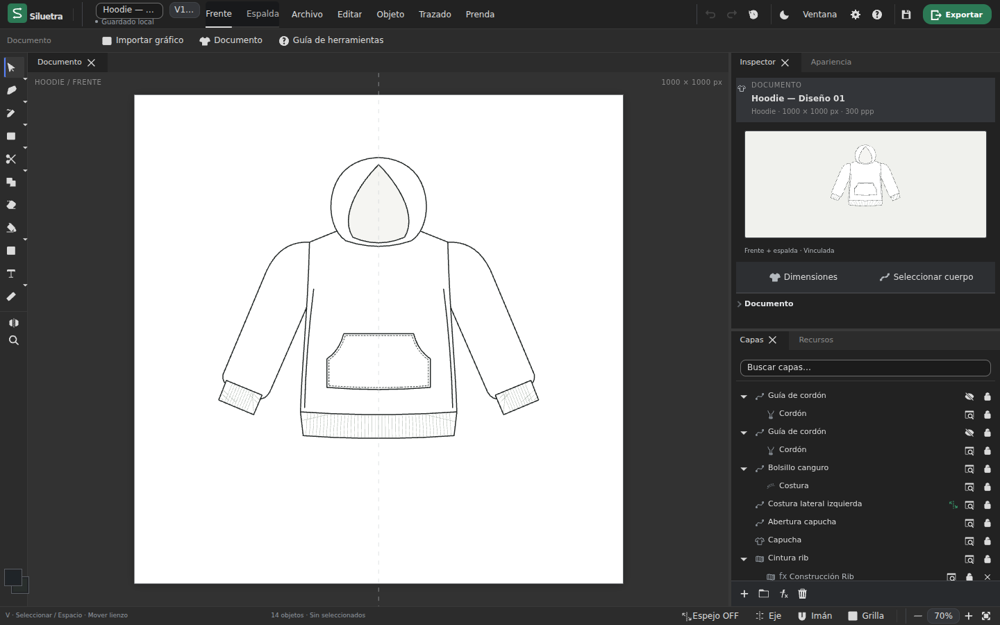

# Siluetra

**Open-source garment flat sketch editor for clothing designers and independent fashion brands.**

Create garment silhouettes, panels, seams, zippers, pockets and garment resources. Apply colors and textures with SVG vector editing. Export SVG/PNG documents and SVG/PNG/JPEG/WebP selections. Native garment JSON preserves editable documents.

Siluetra makes visual garment mockups simpler and faster. It is not pattern-making software, manufacturing CAD, grading software, or a replacement for general-purpose Illustrator/Affinity workflows.



## Development

Use Node 22.20.0 and npm. Serve over HTTP, not file://.

```sh
npm ci
npm start
npm test
npm run build
npm run validate
npm run qa:validate
```

Open http://127.0.0.1:4173. `dist/` is maintained source and static site. Build regenerates only Spectrum/Dockview vendor UI. See [development](docs/development.md) for browser QA and Windows/WSL.

## Help build Siluetra

Contributors interested in SVG/vector graphics, geometry, UI/UX, fashion/streetwear tools, performance, browser QA, accessibility, documentation and garment resources are welcome. Read [CONTRIBUTING](CONTRIBUTING.md) and [architecture](docs/architecture/README.md).

## License and status

Authorized original code is MIT; third-party components retain their terms in [notices](THIRD_PARTY_NOTICES.md). [Asset provenance](docs/ASSET_PROVENANCE.md) records the owner's confirmation of project-specific AI-assisted assets and the scope of their licensing.
